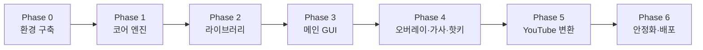

# Ropi — 구현 계획서 (Roadmap)

> 구현 담당(Gemini Hydrogen Extra)은 **Phase 순서대로** 진행하고, 각 Phase의 **완료 기준을 모두 통과한 뒤** 다음 Phase로 넘어간다.
> 각 Phase 종료 시: 테스트 통과 → `git commit` → `git tag phase-N` → `git push`.
> 요구사항 ID(F1-3 등)는 [SPEC.md](SPEC.md) 참조.

---

## Phase 0 — 개발 환경 구축 & 프로젝트 골격

**작업**
1. [SETUP.md](SETUP.md)대로 `scripts/setup-dev.ps1` 실행 (Git, VS Code, Python 3.12, FFmpeg, GitHub CLI, VS Code 확장, venv, 패키지)
2. `pyproject.toml` 작성 (프로젝트명 `ropi`, `src` 레이아웃, ruff/pyright/pytest 설정 포함)
3. `requirements.txt`(앱), `requirements-dev.txt`(개발), `requirements-ai.txt`(전사 엔진) 분리
4. SPEC 6.3 폴더 구조대로 빈 패키지/`__init__.py` 생성
5. `.gitignore` (venv, `__pycache__`, `dist/`, `build/`, `*.spec` 제외 규칙, 로그), `.editorconfig`, `.vscode/settings.json`·`launch.json`·`extensions.json`
6. `core/logging_setup.py`, `core/paths.py`, 전역 예외 훅, 빈 `QMainWindow` 띄우는 `__main__.py`
7. GitHub Actions `ci.yml`: windows-latest에서 ruff + pyright + pytest

**완료 기준**
- [ ] `python -m ropi` 실행 시 빈 창이 뜨고, 로그 파일 생성됨
- [ ] `pytest` / `ruff check` / `pyright` 통과 (더미 테스트 1개)
- [ ] GitHub에 push되고 CI 초록불

---

## Phase 1 — 코어: 음표 모델, 로더, 키맵, 재생 엔진 (UI 없음)

**작업**
1. `domain/note.py`: `NoteEvent`(frozen dataclass), `Song` 메타
2. `formats/midi_loader.py`: mido로 로드, 템포맵 → 절대 ms 변환, 트랙/채널 정보, 드럼 제외 (F1-3)
3. `formats/vp_sheet.py`: VP 텍스트 시트 파서 (`[abc]`=화음, 공백/`|`/`-`=쉼표 규칙, BPM 지정) (F1-1, P1이지만 여기서 같이)
4. `domain/keymap.py` + `assets/keymaps/roblox_61.json`, `roblox_88.json` (pydantic 검증) (F1-14)
5. `domain/arranger.py`: 트랜스포즈, 옥타브 접기/버리기/88키, 자동 트랜스포즈 추천, 속도, 휴머나이즈 → `list[KeyAction]` (F1-5, 7, 8, 9)
6. `playback/win32_input.py`: `SendInput` 스캔코드, `PressedKeyTracker`, `release_all()` (F1-4, 12)
   - 인터페이스 `InputBackend`를 두고 `FakeInputBackend`(테스트용, 타임스탬프 기록) 구현
7. `playback/timing.py`: `timeBeginPeriod(1)`, 하이브리드 `wait_until()` (F1-11)
8. `playback/focus_watcher.py`: 포그라운드 창 프로세스명 확인 (`GetForegroundWindow` → `GetWindowThreadProcessId` → 프로세스명) (F1-13)
9. `playback/scheduler.py` + `service.py`: play/pause/resume/stop/seek/속도 변경 (F1-6)
10. 개발용 CLI: `python -m ropi.tools.play_cli song.mid --transpose 0 --speed 1.0` (실게임 테스트용)

**완료 기준**
- [ ] 키맵 61음 매핑 테스트, arranger 테스트, MIDI 로더 테스트(템포변화/다중트랙/드럼/깨진 파일) 통과
- [ ] FakeInputBackend로 1만 이벤트 타이밍: 평균 오차 ≤ 2ms, p99 ≤ 5ms (결과를 테스트 로그로 출력)
- [ ] 재생 중 예외 강제 발생 테스트 → `pressed_keys` 비어 있음
- [ ] **실게임 검증**: CLI로 Roblox 피아노에서 음계(C 장음계 2옥타브, 반음계 61음 전체) 연주 시 모든 음이 정확히 나옴 → 키맵 `base_midi_note` 확정
- [ ] 커버리지 domain/formats ≥ 85%

---

## Phase 2 — 라이브러리 백엔드

**작업**
1. `library/db.py`: 연결(WAL, foreign_keys ON), 마이그레이션 러너(`migrations/001_init.sql`…), 시작 시 백업 (N4)
2. `library/file_store.py`: 관리 폴더 복사, SHA-256 중복 검사, 휴지통 이동/복원/영구삭제 (F2-2, F2-5)
3. `library/repository.py`: 곡/폴더/태그/가사/재생목록 CRUD
4. `library/search.py`: FTS5 + 초성 인덱스(`domain/hangul.py`), 필터/정렬 쿼리 빌더 (F2-6, F2-7)
5. `library/service.py`: 가져오기(파일·폴더 일괄, 진행률 콜백, 취소), 무결성 검사 (F2-1, F2-11)
6. `formats/ropi_format.py`, `formats/lrc.py`, `library/backup.py`: 내보내기/백업/복원 (F2-9, F3-1)

**완료 기준**
- [ ] CRUD/휴지통/중복/마이그레이션/백업복원 테스트 통과
- [ ] 1만 곡 더미 데이터에서 검색 ≤ 100ms (벤치마크 테스트)
- [ ] 초성 검색 테스트 (`ㅇㄹㅂ` → "아리랑 변주곡")
- [ ] 커버리지 library ≥ 85%

---

## Phase 3 — 메인 GUI

**작업** (SPEC 7장 레이아웃·디자인 토큰 준수)
1. `ui/theme.py` + `assets/themes/dark.qss`, Pretendard 폰트 로드, Lucide 아이콘
2. `main_window.py`: 사이드바 / 페이지 스택(`QStackedWidget`) / 우측 상세 패널 / 하단 플레이어 바
3. `widgets/folder_tree.py`(`QTreeView` + 모델, 드래그&드롭), `song_table.py`(`QTableView` + `QSortFilterProxyModel`, 가상 스크롤)
4. `widgets/search_box.py` (디바운스 200ms, `Ctrl+F`)
5. `dialogs/song_edit.py`, 가져오기 진행 대화상자, 컨텍스트 메뉴, 실행취소 토스트
6. `pages/now_playing_page.py`: `piano_roll.py`(QGraphicsView 또는 QPainter 커스텀), `keyboard_view.py`(61건반 + VP 키 라벨)
7. `widgets/player_bar.py`: PlaybackService 시그널 연결, Roblox 연결 표시등
8. `pages/settings_page.py` (연주/일반 항목 우선), `core/config.py` 원자적 저장 (N5)
9. 단일 인스턴스 (N9), 첫 실행 마법사 (SPEC 7.6)
10. 모든 무거운 작업은 `QThreadPool` 워커로 (N3)

**완료 기준**
- [ ] pytest-qt: 곡 가져오기 → 검색 → 더블클릭 재생 → 정지 시나리오 통과
- [ ] 1만 곡에서 스크롤/검색 시 UI 끊김 없음
- [ ] 125%/150% DPI 스크린샷 확인 (레이아웃 깨짐 없음)
- [ ] 실게임: GUI에서 곡 재생 → 카운트다운 → Roblox 활성화 → 연주 정상

---

## Phase 4 — 오버레이, 가사, 전역 핫키

**작업**
1. `hotkeys/win32_hotkeys.py`: `RegisterHotKey` + 숨은 메시지 창 또는 `QAbstractNativeEventFilter`, 충돌 감지, 재지정 (SPEC F6 핫키 표)
2. `ui/overlay/overlay_window.py`: 프레임리스/항상위/Tool/반투명, 3가지 프리셋, 위치 저장·화면 밖 복귀 (F4-1, 6, 7)
3. `ui/overlay/click_through.py`: `SetWindowLongPtrW`로 `WS_EX_LAYERED | WS_EX_TRANSPARENT` 토글 (F4-2)
4. `domain/lyrics.py`: `LyricsTimeline` (이진탐색으로 현재 줄), 속도 변경 대응 (F3-4)
5. `pages/lyrics_editor_page.py`: 붙여넣기, 탭 싱크, 미세조정, LRC 입출력 (F3-2, 3)
6. 오버레이 ↔ PlaybackService/큐 연결, 연습 모드 키 힌트 (F1-15, F4-3, 4)

**완료 기준**
- [ ] LyricsTimeline 단위 테스트 (경계, 빈 가사, 시간 없는 가사)
- [ ] 실게임: 보더리스 전체화면 Roblox 위에 오버레이 표시, 클릭통과 ON 시 게임 조작 정상, 핫키로 다음곡/일시정지/패닉 동작
- [ ] 가사 탭싱크 → 재생 시 오버레이 가사가 ±100ms 이내로 맞음 (속도 50%/150%에서도)

---

## Phase 5 — YouTube / 오디오 → MIDI 변환

**작업**
1. `convert/youtube.py`: yt-dlp **Python API** 로 메타데이터 조회 + bestaudio 다운로드, 진행률 hook, 길이 제한 (F5-1, 7)
2. `convert/audio_prep.py`: ffmpeg 호출(WAV 모노 리샘플, 무음 제거/정규화 옵션)
3. `convert/worker/transcribe_main.py`: 독립 실행 스크립트. 입력 JSON(args) → stdout에 JSON 라인(`{"stage":"transcribe","progress":0.42}`) → 결과 MIDI 경로
4. `engines/base.py`(인터페이스), `bytedance.py`(piano_transcription_inference, CUDA 자동 감지), `basic_pitch.py`(onnx 백엔드) (F5-3)
5. `convert/postprocess.py`: 최소 길이, 벨로시티 임계, 최대 동시음, 반복음 병합, 양자화 (F5-4)
6. `convert/job_queue.py` + `service.py`: QProcess로 워커 실행, 큐/취소(프로세스 kill + 임시파일 정리)/재시도, DB `convert_jobs` 기록, 완료 시 라이브러리 자동 등록 (F5-5, 6, 8)
7. 모델 다운로드 관리자(진행률, 캐시, 손상 시 재다운로드) (F5-9), yt-dlp 업데이트 버튼 (F5-10)
8. `pages/convert_page.py` (SPEC 7.4 와이어프레임), 첫 사용 시 약관 동의 + AI 모듈 설치 안내

**완료 기준**
- [ ] 엔진 mock 테스트 + 실제 10초 피아노 wav 샘플 → MIDI 생성 통합 테스트
- [ ] 워커 강제 종료/메모리 부족 시뮬레이션에서 메인 앱 정상 유지
- [ ] 실사용: 피아노 솔로 YouTube 영상 3개 변환 → 라이브러리 등록 → Roblox에서 재생해 원곡과 비슷하게 들림
- [ ] 취소 시 임시파일 남지 않음

---

## Phase 6 — 안정화, 선택 기능, 배포

**작업**
1. 전체 퍼징·장시간(2시간) 재생 테스트, 메모리 프로파일링
2. 라이트 테마, 영어 번역(`.ts` → `.qm`)
3. 선택 기능(P2): `.mld` 로더(샘플 확보 시), Transkun 엔진, Demucs 분리, YouTube 재생목록, 실물 MIDI 키보드 입력(MIRP 방식), 간단한 노트 편집기
4. `scripts/build.ps1`: PyInstaller onedir, ffmpeg/yt-dlp 동봉, 버전 정보 리소스, 아이콘
5. (P1) Inno Setup 설치 파일, `.ropi` 확장자 연결
6. `README.md` 사용자 가이드(스크린샷), `CHANGELOG.md`, `THIRD_PARTY_LICENSES.md`
7. GitHub Release v1.0.0 업로드

**완료 기준**
- [ ] 깨끗한 Windows(파이썬 미설치)에서 빌드된 exe 실행 → 모든 P0 기능 동작
- [ ] SPEC 9장 품질 기준 전부 충족
- [ ] 알려진 크래시 0건

---

## 실게임 검증 체크리스트 (각 Phase에서 해당 항목 수행)

- [ ] 61건반 전체 음 정확도 (반음계 상행/하행)
- [ ] 흰+검은 건반 혼합 화음 (예: C-E♭-G)이 동시에 정확히 나옴
- [ ] 빠른 곡(16분음표 BPM 180)에서 음 누락 없음
- [ ] 재생 중 Alt+Tab → 자동 일시정지, 키 눌림 잔류 없음 (채팅창에 문자 입력 안 됨)
- [ ] 패닉 키 즉시 동작
- [ ] Roblox 채팅창이 열려 있을 때 재생 시작하면 경고 (가능하면 감지, 불가하면 안내 문구)
- [ ] 오버레이 클릭통과 ON/OFF, 다중 모니터
- [ ] 2시간 연속 재생목록 반복
