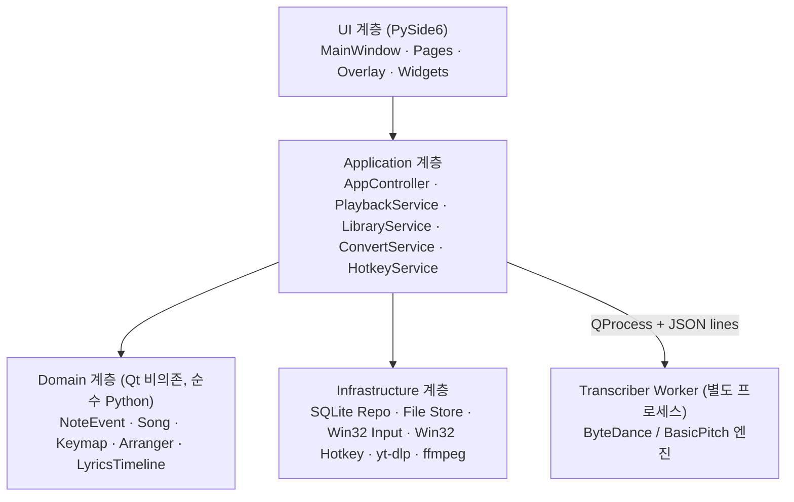
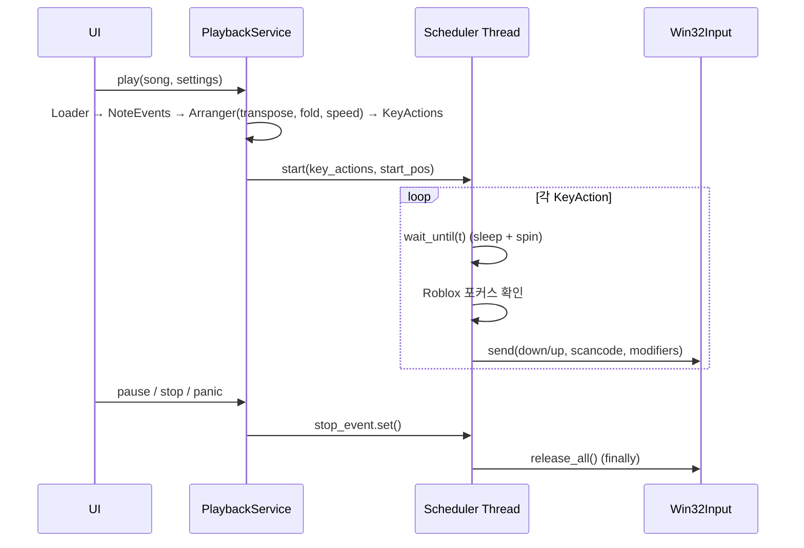
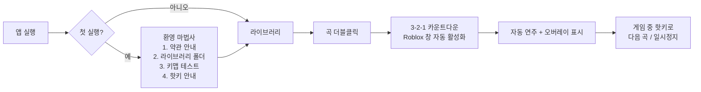

# Ropi — 제품 사양서 (Software Requirements Specification)

> 버전: 1.0 (2026-11-13) · 작성: 설계 담당 (Claude Opus) · 구현 담당: Gemini Hydrogen Extra
> 이 문서는 **"무엇을" 만들지**를 정의합니다. "어떤 순서로" 만들지는 [ROADMAP.md](ROADMAP.md), 개발 환경은 [SETUP.md](SETUP.md)를 보세요.

---

## 0. 한 줄 요약

**Ropi**는 Roblox 게임 안의 가상 피아노(키보드 입력식, 61/88건반)를 대상으로 하는 **Windows 데스크톱 자동 연주기 + 악보 라이브러리 관리 + 인게임 오버레이(가사 표시) + YouTube 피아노 음원 → MIDI 자동 변환** 통합 프로그램이다.

---

## 1. 용어

| 용어 | 의미 |
|---|---|
| VP 키 | Roblox 가상 피아노에서 각 음에 대응하는 키보드 키 (`1`~`m`, Shift/Ctrl 조합) |
| 키맵 (Keymap) | MIDI 음 번호 ↔ VP 키 조합의 매핑 테이블 (JSON 프로필) |
| NoteEvent | 내부 공통 음표 표현 `(start_ms, duration_ms, midi_note, velocity, track)` |
| Song | 라이브러리에 등록된 곡 1개 (원본 파일 + 메타데이터 + 가사 + 곡별 설정) |
| VP 시트 | 커뮤니티에서 공유되는 텍스트 악보 (`[tu] o p | a s ...` 형식) |
| 오버레이 | 게임 위에 항상 떠 있는 반투명 소형 창 |
| 전사 (Transcription) | 오디오 → MIDI 변환 (AI 모델 사용) |

> [!NOTE] **"mld" 파일에 대하여**
> 사용자가 말한 "mld"는 대부분 **MIDI(`.mid` / `.midi`)** 를 의미하는 것으로 판단하여 MIDI를 1순위 포맷으로 한다.
> 실제 `.mld`(일본 피처폰 i-melody/MFi 벨소리 포맷)는 희귀 포맷이므로 **Phase 6 선택 기능**으로 둔다. 샘플 파일이 생기면 그때 파서를 추가한다.

---

## 2. 대상 환경 & 제약

- OS: **Windows 10 22H2 / Windows 11** (64-bit). 관리자 권한 없이 실행 가능해야 함.
- 대상 게임: Roblox (Windows 클라이언트, 창모드/전체화면(보더리스) 모두).
- 대상 피아노: 스크린샷의 61건반 가상 피아노 (흰 건반 `1234567890qwertyuiopasdfghjklzxcvbnm`, 검은 건반 = Shift + 키). 88건반 확장(Ctrl 조합)도 프로필로 지원.
- 인터넷: YouTube 변환 기능에만 필요. 나머지는 오프라인 동작.
- 하드웨어 최소: 4코어 CPU, RAM 8GB. GPU(NVIDIA CUDA)는 있으면 전사 가속, 없어도 CPU로 동작.

---

## 3. 기술 스택 결정

### 3.1 선택: **Python 3.12 + PySide6 (Qt 6)**

| 후보 | 장점 | 단점 | 결론 |
|---|---|---|---|
| **Python + PySide6** | AI 전사 모델(PyTorch/ONNX)·yt-dlp·MIDI 라이브러리가 전부 Python 생태계. Qt는 투명/항상위/클릭통과 오버레이를 안정적으로 지원. 단일 언어로 전체 구현 가능 → AI 구현자(Hydrogen)가 다루기 쉬움 | 배포 용량 큼(전사 모델 포함 시) | ✅ **채택** |
| C# + WPF/WinUI | 네이티브 Windows, 입력 시뮬레이션 쉬움 | AI 전사는 결국 Python 프로세스 필요 → 2개 언어 유지 | ❌ |
| Tauri (Rust + TS) | 가볍고 예쁜 UI (HuMidi 방식) | Rust + TS + Python(전사) 3개 언어, 오버레이 구현 복잡 | ❌ |
| Electron | UI 자유도 | 무겁고 저지연 키 입력에 불리 | ❌ |

### 3.2 라이브러리 목록 (requirements)

| 영역 | 패키지 | 용도 |
|---|---|---|
| GUI | `PySide6>=6.8` | 메인 창, 오버레이, 위젯 |
| MIDI | `mido`, `pretty_midi` | MIDI 읽기/쓰기, 템포맵 처리 |
| DB | 표준 `sqlite3` (FTS5) | 라이브러리 DB, 전문 검색 |
| 입력 | 표준 `ctypes` (Win32 `SendInput`) | 스캔코드 기반 키 입력 (외부 패키지 X) |
| 핫키 | 표준 `ctypes` (Win32 `RegisterHotKey`) | 전역 단축키 |
| YouTube | `yt-dlp` (+ 외부 `ffmpeg.exe`) | 오디오 다운로드/변환 |
| 전사 (고품질, 기본) | `piano_transcription_inference` (ByteDance, PyTorch) | 피아노 전용, 벨로시티·페달 추정 |
| 전사 (경량, 대안) | `basic-pitch[onnx]` (Spotify) | 빠름, GPU 없어도 가벼움 |
| 전사 (선택, 최고품질) | `transkun` | Phase 6 선택 엔진 |
| 오디오 | `librosa`, `soundfile`, `numpy` | 리샘플/전처리 |
| 설정 | `pydantic>=2` | 설정/키맵 스키마 검증 |
| 로깅 | 표준 `logging` + `RotatingFileHandler`, `faulthandler` | 로그 & 크래시 덤프 |
| 테스트 | `pytest`, `pytest-qt`, `pytest-cov` | 단위/GUI 테스트 |
| 품질 | `ruff`, `pyright` | 린트/포맷/타입체크 |
| 배포 | `pyinstaller` | onedir exe 빌드 |
| (선택) 미리듣기 | `QtMultimedia` 또는 `pyfluidsynth` | PC 스피커로 미리듣기 |

### 3.3 참고할 오픈소스 (코드 복사 전 라이선스 확인 필수)

| 프로젝트 | 참고 포인트 |
|---|---|
| `Jed556/AutoMidiPlayer` | Roblox 61/88키 레이아웃, 트랜스포즈, 속도, 자동 포커스, Spotify풍 UI |
| `smyGitt/HuMidi-Roblox-Piano-Autoplayer` | "휴머나이즈"(타이밍 랜덤 흔들림), 페달 처리 |
| `ervareza/Virtual-Piano-Roblox-Player` | Python 기반 MIDI → 키 입력 최소 구현 |
| `GreatCorn/MIRP` | 실제 MIDI 키보드 → Roblox 피아노 실시간 입력 |
| `bytedance/piano_transcription` | 피아노 오디오 → MIDI (기본 엔진) |
| `spotify/basic-pitch` | 경량 오디오 → MIDI |
| `Yujia-Yan/Transkun` | 최고 정확도 피아노 전사 |
| `yt-dlp/yt-dlp` | YouTube 오디오 추출 |

> [!IMPORTANT] GPL 프로젝트의 코드를 **그대로 복사**하면 Ropi 전체가 GPL이 된다. 원칙: **아이디어·알고리즘만 참고하고 코드는 새로 작성**. 직접 의존(import)하는 패키지는 MIT/Apache/BSD/ISC 위주로 사용. 각 의존성 라이선스는 `THIRD_PARTY_LICENSES.md`에 기록.

---

## 4. 기능 요구사항

우선순위: **P0** = 1.0 필수, **P1** = 1.0 목표, **P2** = 이후 버전

### F1. 자동 연주 엔진 (P0)

| ID | 요구사항 |
|---|---|
| F1-1 | 지원 입력 포맷: `.mid/.midi`(P0), VP 텍스트 시트 `.txt`(P1), Ropi 자체 포맷 `.ropi`(P0), `.mld`(P2) |
| F1-2 | 모든 포맷은 로더를 거쳐 공통 `list[NoteEvent]`로 변환된 뒤 재생 (재생 엔진은 포맷을 모름) |
| F1-3 | MIDI 템포 변화(tempo map), 다중 트랙, 채널 10(드럼) 자동 제외, 트랙별 on/off |
| F1-4 | 키 입력은 Win32 `SendInput` + **스캔코드(KEYEVENTF_SCANCODE)** 로 전송 (Roblox는 가상키만 보내면 무시하는 경우가 있음) |
| F1-5 | 검은 건반: `Shift down → 키 down → 키 up → Shift up`. 같은 시각 화음에 흰/검은 건반이 섞이면 **흰 건반 먼저, 검은 건반은 Shift로 묶어서** 전송. 88키 확장음은 Ctrl 조합 |
| F1-6 | 재생 제어: 재생/일시정지/정지/탐색(seek)/이전곡/다음곡/반복(한곡/전체)/셔플 |
| F1-7 | 속도 25%~200% (5% 단위), 트랜스포즈 −24~+24 반음, 옥타브 이동 |
| F1-8 | 음역 밖 음 처리 옵션: ① 옥타브 접기(기본) ② 버리기 ③ 88키 모드 사용. **자동 트랜스포즈 추천**(음역 밖 음 개수 최소화) |
| F1-9 | 휴머나이즈(P1): 타이밍 ±0~30ms 랜덤, 화음 분산(롤) 0~20ms |
| F1-10 | 서스테인: 노트 길이를 키 누름 시간으로 반영(옵션) / 짧게 탭(기본, 피아노가 자체 서스테인) / 페달키(Space) 매핑 옵션 |
| F1-11 | 타이밍 정확도: 이벤트 발사 오차 **평균 ≤ 2ms, p99 ≤ 5ms** (전용 스레드, `timeBeginPeriod(1)`, `perf_counter_ns`, sleep + 마지막 1.5ms 스핀대기 하이브리드) |
| F1-12 | **안전장치**: 정지/일시정지/크래시/프로그램 종료/Roblox 포커스 이탈 시 **눌린 키 전부 즉시 해제** (`try/finally`, `atexit`, 패닉 핫키) |
| F1-13 | 포커스 감시: Roblox 창(`RobloxPlayerBeta.exe`)이 포그라운드가 아니면 자동 일시정지(옵션, 기본 ON). 재생 시작 시 3-2-1 카운트다운 후 Roblox 창 자동 활성화 |
| F1-14 | 키맵은 JSON 프로필(`assets/keymaps/*.json`)로 분리. 설정에서 편집/추가 가능 + **키맵 테스트 도구**(한 음씩 눌러보기) |
| F1-15 | 연습 모드(P1): 키를 보내지 않고, 다음에 눌러야 할 키 글자만 오버레이/메인화면에 표시 (사용자가 직접 연주) |

**기본 키맵 (roblox_61.json, MIDI 36(C2)~96(C7) 기준)**

```
흰 건반(36개):  1 2 3 4 5 6 7 8 9 0 q w e r t y u i o p a s d f g h j k l z x c v b n m
검은 건반(25개): Shift + 1 2 4 5 6 8 9 q w e t y i o p s d g h j l z c v b
                 (= ! @ $ % ^ * ( Q W E T Y I O P S D G H J L Z C V B)
88키 확장: 아래쪽 15음 / 위쪽 12음 = Ctrl + 키 (프로필 roblox_88.json, 실게임 검증 후 확정)
```

> [!WARNING] 실제 게임의 기준 옥타브(첫 키 `1`이 C1인지 C2인지)는 게임마다 다를 수 있다. 키맵 JSON에 `base_midi_note` 필드를 두고, 키맵 테스트 도구로 실게임에서 확인 후 조정한다.

### F2. 라이브러리 (곡/폴더 관리) (P0)

| ID | 요구사항 |
|---|---|
| F2-1 | 곡 추가: 파일 선택 / **드래그&드롭**(파일·폴더 다중) / 폴더 일괄 가져오기(하위폴더 구조 유지 옵션) |
| F2-2 | 곡 파일은 관리 폴더(`문서\Ropi\Library\`)에 **복사**하여 보관 (원본 이동 안 함). 중복은 SHA-256 해시로 감지 → "건너뛰기/사본으로 추가" 선택 |
| F2-3 | 폴더(가상 폴더) 트리: 생성/이름변경/삭제/이동(드래그), 무제한 중첩, 정렬 순서 저장 |
| F2-4 | 곡 수정: 제목, 아티스트, 태그, 메모, 즐겨찾기(★), 난이도(1~5), 곡별 기본 설정(속도/트랜스포즈/트랙 on-off/음역 처리) |
| F2-5 | 곡 삭제: **휴지통**으로 이동(30일 보관) → 복원/영구삭제. 영구삭제 시에만 파일 삭제 |
| F2-6 | 검색: 제목/아티스트/태그/가사 전문검색(SQLite FTS5) + **한글 초성 검색**(`ㄱㄴㄷ`→"가나다") + 입력 즉시 결과(200ms 디바운스) |
| F2-7 | 필터/정렬: 폴더, 태그, 즐겨찾기, 포맷, 길이, 추가일, 최근 재생, 재생 횟수 |
| F2-8 | 재생목록(플레이리스트): 생성/편집/순서변경. 재생 큐는 메인과 오버레이에서 공유 |
| F2-9 | 내보내기: 곡 단일 `.ropi`(곡+가사+설정 포함) / 원본 MIDI / 라이브러리 전체 백업 `.zip` · 복원 |
| F2-10 | 곡 상세 패널: 길이, 음표 수, BPM, 음역(최저~최고), 61키 기준 음역 밖 음 개수, 피아노롤 미리보기 |
| F2-11 | 실행 시 무결성 검사: DB에는 있는데 파일이 없는 곡 → "누락" 표시 및 재연결 기능 |

### F3. 가사 (P0)

| ID | 요구사항 |
|---|---|
| F3-1 | 곡마다 타임스탬프 가사 저장 (DB `lyrics` 테이블 + `.ropi`에 포함). LRC 형식 가져오기/내보내기 |
| F3-2 | 가사 편집기: 텍스트 붙여넣기 → 줄 단위 분리 → **탭 싱크**(곡을 재생하며 Space를 누를 때마다 현재 줄에 시간 기록) |
| F3-3 | 줄별 시간 미세조정(±100ms 버튼, 직접 입력), 전체 오프셋 조정 |
| F3-4 | 재생 시간과 동기화되어 현재 줄 하이라이트, 다음 줄 미리보기. 속도 변경 시에도 곡 시간 기준으로 정확히 맞춤 |
| F3-5 | 타임스탬프 없는 가사도 허용 (오버레이에서 수동 스크롤/다음줄 핫키) |

### F4. 오버레이 (P0)

| ID | 요구사항 |
|---|---|
| F4-1 | 프레임 없는, 항상 위(`WindowStaysOnTopHint`), 반투명(투명도 30~100%), 작업표시줄에 안 뜨는(`Tool`) 창 |
| F4-2 | **클릭 통과 모드** 토글(`WS_EX_TRANSPARENT` + `WS_EX_LAYERED`) — 게임 조작 방해 없음. 해제 시 드래그 이동/크기조절 가능 |
| F4-3 | 표시 요소(각각 on/off): 현재 곡명·진행바·시간 / 재생 큐(이전·다음 곡) / 가사(현재 줄 크게 + 다음 줄) / 연습모드 키 힌트 / 상태(재생중·일시정지·포커스 대기) |
| F4-4 | 오버레이 조작: 곡 목록에서 곡 선택, 이전/다음, 재생/일시정지, 속도 ± (클릭 통과 해제 상태에서) |
| F4-5 | 모든 핵심 조작은 **전역 핫키**로도 가능 (게임 중 alt-tab 불필요) |
| F4-6 | 위치/크기/투명도/표시항목/글꼴크기 저장. 다중 모니터 지원, 화면 밖으로 나가면 자동 복귀 |
| F4-7 | 레이아웃 프리셋 3종: **미니**(곡명+진행바), **가사**(가사 중심), **풀**(큐+가사+컨트롤) |

> [!NOTE] Roblox는 기본적으로 보더리스 전체화면이라 Qt 최상위 창이 위에 표시된다. 독점 전체화면 환경에서는 표시되지 않을 수 있으며, 이 경우 안내 메시지를 띄운다.

### F5. YouTube → MIDI 자동 변환 (P0)

파이프라인:

```
URL 입력 → URL 검증 → 메타데이터 조회(제목/길이/썸네일)
 → 오디오 다운로드(yt-dlp, bestaudio) → ffmpeg로 WAV 변환(모노, 엔진 요구 샘플레이트)
 → [선택] 앞뒤 무음 제거 / 음량 정규화
 → AI 전사 (별도 프로세스) → 후처리 → .mid 저장 → 라이브러리 "YouTube 변환" 폴더에 자동 등록
```

| ID | 요구사항 |
|---|---|
| F5-1 | 입력: YouTube URL (단일 영상, Shorts 포함). 재생목록 URL은 P2 |
| F5-2 | **로컬 오디오 파일**(mp3/wav/m4a/flac)도 같은 파이프라인으로 변환 |
| F5-3 | 엔진 선택: `ByteDance(고품질, 기본)` / `Basic Pitch(빠름)` / `Transkun(P2)`. GPU 자동 감지(CUDA 있으면 사용) |
| F5-4 | 후처리 옵션: 최소 음 길이(기본 30ms), 최소 벨로시티 임계값(유령음 제거), 동시 발음 최대 개수(기본 10), 짧은 반복음 병합, (선택) 박자 양자화 |
| F5-5 | 작업 큐: 여러 링크 대기열, 단계별 진행률(다운로드 %, 전사 %), **취소 가능**, 실패 시 원인 메시지 + 재시도 |
| F5-6 | 전사는 **별도 프로세스(QProcess/subprocess)** 에서 실행. 워커가 죽어도 메인 앱은 절대 죽지 않음. JSON 라인으로 진행률 통신 |
| F5-7 | 기본 제한: 최대 영상 길이 15분(설정 변경 가능), 임시 파일은 완료/취소 시 삭제 |
| F5-8 | 생성된 곡에 `source_url`, 엔진명, 변환일 메타데이터 저장. 변환 후 바로 미리보기(피아노롤) |
| F5-9 | 모델 가중치는 최초 사용 시 다운로드(진행률 표시), `%LOCALAPPDATA%\Ropi\models\`에 캐시 |
| F5-10 | yt-dlp는 YouTube 변경에 자주 깨지므로 설정에 **"yt-dlp 업데이트"** 버튼 제공 |
| F5-11 | (P2) 피아노 외 소리가 섞인 음원용 **Demucs 음원 분리** 전처리 옵션 |

> [!CAUTION] YouTube 콘텐츠 다운로드는 YouTube 약관 및 저작권의 영향을 받는다. 앱 최초 사용 시 "본인이 권리를 가진 콘텐츠 또는 개인적 용도로만 사용" 안내 동의 화면을 표시한다. 또한 Roblox 자동 입력 도구 사용에 따른 계정 위험은 사용자 책임임을 고지한다.

### F6. 설정 (P0)

- 일반: 언어(한국어 기본/영어), 테마(다크 기본/라이트), 시작 시 마지막 곡 불러오기, 라이브러리 경로 변경(이동 마법사)
- 연주: 키맵 프로필, 음역 밖 처리, 기본 속도, 카운트다운 초, 포커스 자동 일시정지, 휴머나이즈, 키 누름 시간
- 핫키: 모든 전역 핫키 재지정 + 충돌 감지
- 오버레이: 프리셋, 투명도, 글꼴 크기, 표시항목
- 변환: 엔진, GPU 사용, 후처리 기본값, 최대 길이, ffmpeg/yt-dlp 경로
- 고급: 로그 폴더 열기, 진단 정보 복사, 설정 초기화

**기본 전역 핫키** (Roblox가 쓰는 F9(개발자 콘솔)/F11(전체화면)/F12, 피아노 키 영역은 피함)

| 동작 | 기본 키 |
|---|---|
| 재생 / 일시정지 | `Home` |
| 정지 | `End` |
| 이전 곡 / 다음 곡 | `Page Up` / `Page Down` |
| 속도 −5% / +5% | `Ctrl+Alt+←` / `Ctrl+Alt+→` |
| 오버레이 표시 토글 | `Insert` |
| 오버레이 클릭통과 토글 | `Ctrl+Alt+O` |
| 가사 다음 줄 (수동) | `Ctrl+Alt+↓` |
| **패닉(모든 키 해제 + 정지)** | `Pause/Break` |

---

## 5. 비기능 요구사항 (안정성 최우선)

| ID | 요구사항 |
|---|---|
| N1 | **크래시 제로 목표**: 전역 예외 훅(`sys.excepthook`, `threading.excepthook`, Qt 메시지 핸들러) → 로그 기록 + 사용자 친화 오류 대화상자, 앱은 계속 동작 |
| N2 | `faulthandler`로 네이티브 크래시 덤프를 `logs\crash-*.log`에 기록 |
| N3 | **UI 스레드에서 블로킹 금지**: 파일 IO 대량 처리·DB 대량 작업·네트워크·전사는 `QThreadPool`/워커 프로세스. UI 프리즈 100ms 초과 금지 |
| N4 | DB: WAL 모드, 모든 쓰기는 트랜잭션, 스키마 버전 + 마이그레이션, 시작 시 자동 백업(최근 5개) |
| N5 | 설정 파일 원자적 저장(임시파일 작성 → `os.replace`), 손상 시 기본값으로 복구 + 손상본 보관 |
| N6 | 손상된/이상한 MIDI 파일은 로드 실패로 처리하고 오류 표시 (앱 종료 X). 퍼징 테스트 포함 |
| N7 | 시작 시간 ≤ 2초(전사 모듈은 지연 로딩), 1만 곡 라이브러리에서 검색 응답 ≤ 100ms |
| N8 | 메모리: 유휴 시 ≤ 250MB (전사 워커 제외) |
| N9 | 단일 인스턴스 실행 (`QLocalServer`), 두 번째 실행 시 기존 창 활성화 + 전달된 파일 열기 |
| N10 | 고DPI(100~200%) 대응, 키보드만으로 전체 조작 가능, 모든 문자열 `tr()` 처리(다국어) |
| N11 | 로그: `%LOCALAPPDATA%\Ropi\logs\`, 5MB × 5개 로테이션, 개인정보(전체 경로 외) 미기록 |

---

## 6. 아키텍처

### 6.1 계층 구조



- **Domain 계층은 Qt·Win32에 의존하지 않는다** → pytest로 100% 단위 테스트 가능.
- UI ↔ 서비스 통신은 Qt Signal/Slot. 서비스는 UI를 직접 참조하지 않는다.
- 재생 엔진은 전용 `threading.Thread`(고정밀 타이머)에서 동작하고, 상태 변경은 Signal로 UI에 전달(초당 최대 30회로 스로틀).

### 6.2 재생 엔진 상세



- `KeyAction = (time_ns, kind: DOWN|UP, scancode, modifier: NONE|SHIFT|CTRL)`; 같은 시각 액션은 "modifier 없는 것 → SHIFT 그룹 → CTRL 그룹" 순으로 정렬.
- Seek = 현재 스케줄 중단 → 해당 시점 이후 액션으로 재시작.
- 속도 변경은 재생 중에도 적용 (현재 곡 위치를 기준으로 남은 액션 시간 재계산).
- `PressedKeyTracker`가 현재 눌린 키 집합을 관리하여 `release_all()`이 확실히 동작.

### 6.3 폴더 구조 (구현 목표)

```
Ropi/
├─ GEMINI.md                  # 구현 AI용 작업 규칙
├─ README.md
├─ pyproject.toml / requirements*.txt
├─ docs/                      # SPEC, ROADMAP, SETUP, UI_UX
├─ scripts/                   # setup-dev.ps1, build.ps1, run.ps1
├─ assets/
│  ├─ keymaps/roblox_61.json, roblox_88.json
│  ├─ icons/ (SVG), fonts/ (Pretendard)
│  └─ themes/dark.qss, light.qss
├─ src/ropi/
│  ├─ __main__.py             # 진입점 (단일 인스턴스, 예외훅, 앱 시작)
│  ├─ app.py                  # AppController (서비스 조립)
│  ├─ core/                   # paths.py, config.py, logging_setup.py, errors.py, single_instance.py
│  ├─ domain/                 # note.py, song.py, keymap.py, arranger.py, lyrics.py, hangul.py(초성)
│  ├─ formats/                # midi_loader.py, vp_sheet.py, ropi_format.py, lrc.py, mld_loader.py(P2)
│  ├─ playback/               # scheduler.py, win32_input.py, focus_watcher.py, service.py, timing.py
│  ├─ library/                # db.py, migrations/, repository.py, file_store.py, search.py, service.py, backup.py
│  ├─ convert/                # youtube.py, audio_prep.py, job_queue.py, service.py, postprocess.py
│  │  └─ worker/              # transcribe_main.py, engines/{base,bytedance,basic_pitch}.py
│  ├─ hotkeys/                # win32_hotkeys.py, service.py
│  └─ ui/
│     ├─ main_window.py, theme.py, icons.py
│     ├─ pages/               # library_page, now_playing_page, convert_page, lyrics_editor_page, settings_page
│     ├─ widgets/             # player_bar, folder_tree, song_table, search_box, keyboard_view, piano_roll, toast
│     ├─ dialogs/             # song_edit, import_progress, error_dialog, first_run
│     └─ overlay/             # overlay_window.py, overlay_layouts.py, click_through.py
└─ tests/                     # unit/, integration/, gui/, fixtures/(샘플 mid, 깨진 mid)
```

### 6.4 데이터 저장 위치

| 데이터 | 경로 |
|---|---|
| DB | `%APPDATA%\Ropi\ropi.db` (+ `backups\`) |
| 설정 | `%APPDATA%\Ropi\settings.json` |
| 곡 파일 | `%USERPROFILE%\Documents\Ropi\Library\` (변경 가능) |
| 휴지통 | `...\Library\.trash\` |
| 모델/캐시/로그 | `%LOCALAPPDATA%\Ropi\{models,cache,logs}\` |

### 6.5 DB 스키마 (SQLite)

```sql
CREATE TABLE schema_version (version INTEGER NOT NULL);

CREATE TABLE folders (
  id INTEGER PRIMARY KEY, parent_id INTEGER REFERENCES folders(id) ON DELETE CASCADE,
  name TEXT NOT NULL, sort_order INTEGER DEFAULT 0, created_at TEXT NOT NULL,
  UNIQUE(parent_id, name)
);

CREATE TABLE songs (
  id INTEGER PRIMARY KEY, folder_id INTEGER REFERENCES folders(id) ON DELETE SET NULL,
  title TEXT NOT NULL, artist TEXT DEFAULT '', memo TEXT DEFAULT '',
  file_rel_path TEXT NOT NULL, format TEXT NOT NULL,          -- 'mid' | 'txt' | 'ropi' | 'mld'
  file_hash TEXT NOT NULL, duration_ms INTEGER, note_count INTEGER, bpm REAL,
  min_note INTEGER, max_note INTEGER, difficulty INTEGER, favorite INTEGER DEFAULT 0,
  play_count INTEGER DEFAULT 0, last_played_at TEXT,
  source_url TEXT, source_engine TEXT,
  settings_json TEXT DEFAULT '{}',                           -- 곡별 속도/트랜스포즈/트랙 등
  deleted_at TEXT,                                           -- 휴지통
  created_at TEXT NOT NULL, updated_at TEXT NOT NULL
);

CREATE TABLE tags (id INTEGER PRIMARY KEY, name TEXT UNIQUE NOT NULL, color TEXT);
CREATE TABLE song_tags (song_id INTEGER REFERENCES songs(id) ON DELETE CASCADE,
                        tag_id INTEGER REFERENCES tags(id) ON DELETE CASCADE, PRIMARY KEY(song_id, tag_id));

CREATE TABLE lyrics (
  id INTEGER PRIMARY KEY, song_id INTEGER REFERENCES songs(id) ON DELETE CASCADE,
  line_no INTEGER NOT NULL, time_ms INTEGER, text TEXT NOT NULL
);

CREATE TABLE playlists (id INTEGER PRIMARY KEY, name TEXT NOT NULL, created_at TEXT NOT NULL);
CREATE TABLE playlist_items (playlist_id INTEGER REFERENCES playlists(id) ON DELETE CASCADE,
  song_id INTEGER REFERENCES songs(id) ON DELETE CASCADE, position INTEGER NOT NULL);

CREATE TABLE convert_jobs (
  id INTEGER PRIMARY KEY, source TEXT NOT NULL, engine TEXT NOT NULL, status TEXT NOT NULL,
  progress REAL DEFAULT 0, error TEXT, song_id INTEGER, created_at TEXT NOT NULL
);

CREATE VIRTUAL TABLE song_fts USING fts5(title, artist, tags, lyrics, chosung, content='', tokenize='unicode61');
```

### 6.6 `.ropi` 자체 포맷 (ZIP 컨테이너)

```
song.ropi (zip)
├─ manifest.json   {"format":"ropi","version":1,"title":..,"artist":..,"tags":[..],"settings":{..},"source_url":..}
├─ music.mid       # 원본 MIDI
└─ lyrics.lrc      # 타임스탬프 가사 (선택)
```

---

## 7. UI / UX 설계

### 7.1 디자인 원칙

1. **게임 중엔 오버레이, 게임 밖에선 메인 창** — 두 화면의 역할을 명확히 분리
2. **다크 테마 기본** (게임 화면과 어울림), 강조색 하나 (`#7C5CFF` 보라 계열)
3. **3클릭 규칙**: 어떤 곡이든 3번 이내 클릭으로 재생
4. 위험한 동작(영구삭제, 폴더 삭제)만 확인창, 나머지는 **실행취소 토스트**("곡을 휴지통으로 옮겼습니다 · 실행취소")
5. 빈 화면에는 항상 다음 행동 안내 (예: "여기에 MIDI 파일을 끌어다 놓으세요")

### 7.2 디자인 토큰

| 토큰 | 다크 | 라이트 |
|---|---|---|
| 배경 | `#16161C` | `#F7F7FA` |
| 패널 | `#1F1F27` | `#FFFFFF` |
| 표면(hover) | `#2A2A35` | `#EEEEF3` |
| 텍스트 | `#ECECF1` | `#1A1A22` |
| 보조 텍스트 | `#9A9AAE` | `#6A6A7A` |
| 강조 | `#7C5CFF` | `#6A4BEF` |
| 성공/경고/오류 | `#3DD68C` / `#FFB547` / `#FF5C7A` | 동일 |

- 글꼴: **Pretendard** (번들, OFL 라이선스) → 없으면 `Malgun Gothic`
- 모서리 8px, 간격 4의 배수(4/8/12/16/24), 아이콘: Lucide SVG (ISC 라이선스)

### 7.3 메인 창 레이아웃 (기본 1280×800, 최소 960×600)

```
┌──────────────────────────────────────────────────────────────────────────┐
│ 🎹 Ropi                       [🔍 곡, 아티스트, 가사, 초성 검색...  ]  ─ □ ✕ │
├────────────┬─────────────────────────────────────────────┬───────────────┤
│ 📚 라이브러리 │  폴더: 전체 > J-POP                [+ 추가] [⬇ 가져오기] │  곡 상세       │
│ ▶ 지금 재생  │ ┌─────────────────────────────────────────┐ │ ┌───────────┐ │
│ 🔄 YouTube변환│ │ ★ │ 제목          │ 아티스트 │ 길이 │ 태그  │ │ │ 피아노롤    │ │
│ 🎤 가사 편집 │ │ ★ │ 夜に駆ける     │ YOASOBI │ 4:21 │ 애니  │ │ │ 미리보기    │ │
│ 📋 재생목록  │ │   │ River Flows.. │ Yiruma  │ 3:10 │ 클래식│ │ └───────────┘ │
│ 🗑 휴지통    │ │   │ ...           │         │      │       │ │ BPM 130       │
│────────────│ └─────────────────────────────────────────┘ │ 음역 C2–B6     │
│ 📁 폴더       │                                             │ 범위밖 3음 ⚠   │
│  ├ 전체       │                                             │ [▶ 재생]       │
│  ├ J-POP      │                                             │ [✎ 편집]       │
│  ├ 클래식     │                                             │ [🎤 가사]      │
│  └ YouTube변환│                                             │               │
│ [+ 새 폴더]  │                                             │               │
│ ⚙ 설정      │                                             │               │
├────────────┴─────────────────────────────────────────────┴───────────────┤
│ ◀◀  ▶  ▶▶  ⏹ │ 夜に駆ける – YOASOBI  ━━━━━━●───────── 1:32 / 4:21 │ 속도 100% ▾ │ 조 +0 ▾ │ 🔁 │ 🖥 오버레이 │ ● Roblox 연결됨 │
└──────────────────────────────────────────────────────────────────────────┘
```

- **좌측 사이드바**(220px, 접기 가능): 내비게이션 + 폴더 트리 (드래그로 곡을 폴더에 넣기)
- **중앙**: 현재 페이지. 라이브러리는 정렬 가능한 테이블 (더블클릭=재생, 우클릭=컨텍스트 메뉴: 재생/큐에 추가/편집/가사/폴더 이동/내보내기/삭제)
- **우측 상세 패널**(280px, 토글): 선택한 곡의 정보·미리보기·빠른 동작
- **하단 플레이어 바**(항상 표시): 재생 제어, 진행바(드래그 탐색), 속도/조 드롭다운, 반복, 오버레이 토글, **Roblox 연결 상태 표시등**(초록=Roblox 창 감지, 회색=미감지)
- 검색창은 상단 고정, `Ctrl+F`로 포커스, 결과는 현재 페이지에 즉시 반영

### 7.4 페이지별 설계

**▶ 지금 재생**
- 상단: 곡 정보 큰 표시 + 트랙 목록(트랙별 on/off 체크, 악기명, 음표 수)
- 중앙: **피아노롤** (스크롤 동기화, 재생선) + 하단 **61건반 키보드 뷰** (눌리는 키 하이라이트 + 각 건반에 VP 키 글자 표시 — 스크린샷의 게임 피아노와 동일한 라벨)
- 우측: 재생 큐 (드래그 정렬)
- 설정 칩: 음역 처리 / 휴머나이즈 / 연습 모드 / 키 누름 방식

**🔄 YouTube 변환**
```
┌─────────────────────────────────────────────────────────┐
│ [ https://youtube.com/watch?v=...              ] [변환] │
│ 또는 [📂 오디오 파일 선택]                               │
│ 엔진: (●) 고품질 ByteDance  ( ) 빠름 Basic Pitch  GPU: ✔ │
│ ▸ 고급 옵션 (최소 음 길이, 임계값, 양자화...)            │
├─────────────────────────────────────────────────────────┤
│ 작업 목록                                                │
│ [썸네일] River Flows in You   ✔ 완료  [▶ 재생][📁 보기] │
│ [썸네일] 夜に駆ける piano      전사 중 ━━━━●──── 63% [✕] │
│ [썸네일] ...                   대기 중               [✕] │
└─────────────────────────────────────────────────────────┘
```
- 단계 표시: `① 정보 확인 → ② 다운로드 → ③ 오디오 변환 → ④ AI 전사 → ⑤ 저장`
- 실패 시 사람이 읽을 수 있는 원인 ("영상이 비공개입니다", "yt-dlp 업데이트가 필요합니다 [업데이트]")

**🎤 가사 편집**
- 좌: 곡 선택 + 미니 플레이어 / 중: 가사 줄 테이블(시간 | 텍스트) / 우: 오버레이 미리보기
- 버튼: [텍스트 붙여넣기] [LRC 불러오기] [탭 싱크 시작(Space)] [전체 오프셋 ±] [LRC 내보내기]

**⚙ 설정**: 좌측 카테고리 목록 + 우측 폼, 변경 즉시 저장, 각 항목에 설명 툴팁, "기본값으로" 버튼

### 7.5 오버레이 레이아웃

```
[미니 프리셋 - 340×64]
┌──────────────────────────────────┐
│ ▶ 夜に駆ける        1:32 / 4:21   │
│ ━━━━━━━━━●──────────  100% · +0  │
└──────────────────────────────────┘

[가사 프리셋 - 520×140]
┌──────────────────────────────────────────┐
│ ▶ 夜に駆ける – YOASOBI         1:32/4:21 │
│                                          │
│      沈むように溶けてゆくように            │  ← 현재 줄 (크게, 강조색)
│      二人だけの空が広がる夜に              │  ← 다음 줄 (작게, 흐리게)
└──────────────────────────────────────────┘

[풀 프리셋 - 360×420]
┌────────────────────────────┐
│ ≡ Ropi Overlay    👁 🔒 ✕  │  ← 🔒 = 클릭통과 토글
│ ▶ 夜に駆ける     1:32/4:21 │
│ ━━━━━━●──────────────────  │
│ ◀◀  ⏸  ▶▶   속도 [-] 100% [+] │
│ ── 가사 ─────────────────── │
│  沈むように溶けてゆくように   │
│  二人だけの空が広がる夜に     │
│ ── 다음 곡 ───────────────── │
│  2. River Flows in You     │
│  3. Canon in D             │
│ ── 연습 힌트 ─────────────── │
│  [t] [u] o p [tu] ...      │
└────────────────────────────┘
```
- 배경: 반투명 검정(`rgba(16,16,22,0.75)`) + 8px 라운드 + 텍스트 그림자(어떤 게임 배경에서도 읽히도록)
- 클릭통과 ON 상태에서는 테두리가 사라지고 오버레이 우상단에 작은 🔒 아이콘만 표시

### 7.6 UX 흐름 (핵심 시나리오)



---

## 8. 오류 처리 정책

| 상황 | 처리 |
|---|---|
| Roblox 미실행 상태에서 재생 | "Roblox 창을 찾을 수 없습니다" 토스트 + [그래도 재생] 옵션 |
| 재생 중 포커스 이탈 | 자동 일시정지 + 키 전부 해제 + 오버레이에 "⏸ Roblox 포커스 대기" |
| MIDI 파싱 실패 | 가져오기 결과 요약 대화상자에 실패 목록 + 사유 |
| 라이브러리 파일 누락 | 테이블에 ⚠ 표시, [파일 다시 찾기] |
| 네트워크/yt-dlp 실패 | 오류 코드별 한국어 메시지 + 재시도 / yt-dlp 업데이트 버튼 |
| 전사 워커 크래시/메모리 부족 | 작업 실패 처리, "Basic Pitch(가벼운 엔진)로 다시 시도" 제안 |
| 디스크 공간 부족 | 저장 전 확인, 부족 시 중단 + 안내 |
| 예상치 못한 예외 | 오류 대화상자([로그 폴더 열기] [진단 정보 복사]) + 앱은 계속 실행 |

---

## 9. 테스트 & 품질 기준 (Definition of Done)

- `ruff check` / `ruff format --check` / `pyright` 오류 0
- 단위 테스트 커버리지: `domain/`, `formats/`, `library/` **≥ 85%**, 전체 ≥ 70%
- 필수 테스트:
  - 키맵: 61음 전부 올바른 키/모디파이어로 변환, 음역 밖 처리 3가지 모드
  - MIDI: 템포 변화, 다중 트랙, 드럼 채널, 0길이 노트, 겹치는 노트, **깨진 파일 50종 퍼징**
  - 스케줄러: 가짜 입력 백엔드로 1만 이벤트 타이밍 오차 측정 (평균 ≤ 2ms)
  - 안전장치: 재생 중 stop/예외 발생 시 `pressed_keys`가 비어 있음
  - DB: 마이그레이션, 휴지통/복원, FTS·초성 검색, 동시성(워커 쓰기 + UI 읽기)
  - 변환: 짧은 샘플 wav → MIDI 생성 (CI에선 엔진 mock)
  - GUI(pytest-qt): 곡 추가→검색→재생 버튼→정지, 오버레이 토글
- 수동 테스트 체크리스트(실제 Roblox): [ROADMAP.md](ROADMAP.md) "실게임 검증" 항목
- 2시간 연속 재생(재생목록 반복) 메모리 누수 없음

---

## 10. 배포

- PyInstaller **onedir** 빌드 → `Ropi\Ropi.exe` + 포함: `ffmpeg.exe`, `yt-dlp.exe`, assets
- 전사 엔진(PyTorch 포함, 대용량)은 **선택 컴포넌트**: 최초 변환 시 "AI 변환 모듈 설치(약 1GB)" 안내 후 별도 venv/폴더에 설치 → 메인 앱 용량 ≈ 150MB 유지
- (P1) Inno Setup 설치 프로그램, 시작 메뉴 바로가기, `.ropi` 파일 연결
- 버전: SemVer, `CHANGELOG.md`, GitHub Releases 업로드
